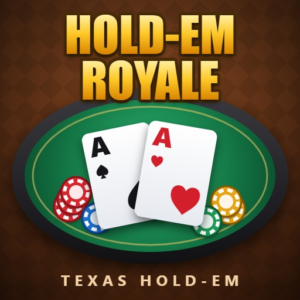

# Hold-em Royale

A fun, simple Texas Hold-em game in a single HTML file: sit down at a 5-player table against computer opponents, play cash games or Sit-N-Go tournaments, and build up your bankroll.



## Play

Open `TexasHoldem.html` in any modern browser. There is no build step and nothing to install. On its own the page plays offline against computer opponents.

For multiplayer cash tables, run the game server in `server/` (see [Multiplayer](#multiplayer)).

## Game modes

| Mode | How it works |
| --- | --- |
| Cash Game | Pick a stage (blinds from $10/$20 up to the $5K/$10K high-roller table), buy in, and leave whenever you like. Your chips go back to your bankroll when you leave. Busted opponents are replaced by new players. When the multiplayer server is online, everyone who picks the same stage shares a table, and real players take over the bots' seats. |
| Sit-N-Go | Five players start with 1,500 tournament chips each. The blinds go up every 5 hands. Last player standing wins 3.5× the buy-in, and 2nd place wins 1.5×. |

You start with $10,000. You can collect $2,000 in free chips every 3 hours, or at any time when you can't afford the smallest table.

## Controls

| Action | Input |
| --- | --- |
| Fold | Fold button, or F |
| Check / Call | Check/Call button, or C / Space |
| Bet / Raise | Raise button, or R (use the slider or the MIN, ½ POT, POT and ALL-IN presets to pick the amount) |
| Mute | M, or the speaker button |
| Quick chat | 💬 button |
| Menu (leave table, sound, win-chance meter, speed) | ☰ button |

## Features

- Full Texas Hold-em rules: blinds, a rotating dealer button, min-raises, all-ins and side pots
- Opponents with their own personalities, from tight and cautious to loose and aggressive
- A win-chance meter that estimates your odds against the players still in the hand (you can hide it from the menu)
- A profile that tracks your hands played, win rate, biggest pot, Sit-N-Go wins and best hand ever
- Sound effects synthesized with the Web Audio API, so there are no audio files to load

Your bankroll, stats and settings are saved in the browser's local storage.

## Multiplayer

The `server/` folder contains a small Node.js server that runs shared cash tables:

- Every table has 5 seats. When a real player sits down, they take a bot's seat (from the next hand if one is in progress), and when they leave, a bot takes the seat back. When a table is full of real players, the next player gets a new table.
- The server shuffles and deals, so a player's browser never receives anyone else's hole cards until a showdown.
- Real players have 5 seconds to act, with a countdown on their seat. When time runs out they check, or fold if someone has bet. After three timeouts in a row they sit out until they click **I'm back**.
- Every player's picture has a badge: 🤖 for computer players and 👤 for real players.
- Notices at the top of the table say when players join, wait for the next hand, sit down, leave or sit out.
- Bankrolls stay in each player's own browser. The server only tracks the chips on the table.
- If the server can't be reached, cash games fall back to offline play against bots. Sit-N-Go tournaments are always offline.

To run it on your computer (needs Node.js 18 or newer):

```bash
cd server
npm install
npm start
```

Then open http://localhost:3000 in two browser windows and pick the same cash stage in both.

To put the server online and connect your website to it, follow [DEPLOY.md](DEPLOY.md).
